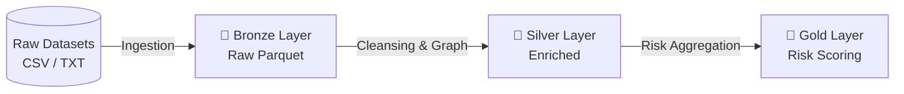

# Anti-Money Laundering (AML) Data Pipeline | Medallion Architecture


-green?style=for-the-badge)

---

## 📌 Executive Summary
* **What it does:** Enterprise-grade end-to-end PySpark ETL pipeline processing **31.8M+ financial transaction records** and **2.1M+ banking entities** to detect complex Anti-Money Laundering (AML) fraud schemes.
* **How it works:** Implements a strict **Medallion Architecture** (Bronze, Silver, Gold) for schema enforcement, entity resolution via map-side joins, temporal window aggregations, and topological graph pattern identification (Fan-In/Fan-Out).
* **Business Impact:** Delivers certified, automated composite risk scores (0-100 scale) per entity, highlighting high-velocity pass-through transfers, circular laundering loops, and structural smurfing anomalies.

---

## 🏗️ Architecture & Data Flow

The data flow strictly adheres to the **Medallion Lakehouse Pattern**, guaranteeing data quality, immutability, and lineage traceability across execution stages:




### 🥉 Bronze Layer (Raw Ingestion)
* **Storage Format:** Apache Parquet with Snappy Compression (`data/bronze/`).
* **Ingestion Logic:** Explicit PySpark `StructType` schema enforcement. Bypasses automatic `inferSchema` passes across 31.8M+ rows, reducing I/O startup overhead from minutes to milliseconds.

### 🥈 Silver Layer (Cleansing, Enrichment & Graph Analytics)
* **Sanitization & Normalization:** Vectorized string cleansing (`regexp_replace`, `trim`), currency rate unification across 15 global currencies to USD benchmarks, and microsecond-precision `TimestampType` parsing.
* **Deduplication:** Tungsten hash-based deduplication (`dropDuplicates()`) across accounts and transaction logs.
* **Map-Side Entity Enrichment:** Broadcast Hash Joins (BHJ) integrating 2.1M+ account dimension lookup records into the 31.8M+ transaction stream without network shuffle.
* **Feature Engineering:**
  * **Window Analytics:** 3-transaction moving average and monetary spike flags (`is_amount_spike`).
  * **Topological Graph Patterns:** Directional network degree metrics detecting Fan-In (many-to-one pooling) and Fan-Out/Smurfing (one-to-many dispersion) with `degree_count > 5`.
  * **Temporal Velocity & Cycles:** Detection of rapid pass-through transfers (inflow/outflow \\(\le\\) 60 min) and circular round-trip laundering loops (A \\(\rightarrow\\) B \\(\rightarrow\\) A \\(\le\\) 24 hours) via stateful window lag analysis.

### 🥇 Gold Layer (Risk Scoring & Aggregation)
* **Composite Risk Engine:** Consolidates temporal velocity, monetary spikes, and graph topologies into a deterministic, weighted AML Risk Score (0-100 scale) per entity.
* **Certified Output:** Exported to `data/gold/risk_score_aggregation_parquet` for direct downstream consumption by BI dashboards, graph analytics engines, and compliance audit systems.
 
## 🛠️ Key Engineering Optimizations

Processing **31.8M+ transaction records** and **2.1M+ account entities** on resource-constrained single-node/containerized infrastructure (e.g., Google Colab / Local VM with 8GB RAM) requires strict memory boundaries, shuffle elimination, and vectorization.

### 1. Memory Management & OOM Prevention
* **Isolated Subprocess RAM Garbage Collection:** The master orchestrator (`main.py`) invokes each execution stage in an isolated Python sub-process via `subprocess.run()`. This design pattern guarantees complete termination of the underlying JVM driver/executor process after each step, purging off-heap memory and preventing cumulative OutOfMemory (OOM) memory leaks across long-running ETL workflows.
* **Driver & Executor Heap Allocation:** Configures explicit `spark.driver.memory=8g` and `spark.executor.memory=8g` limits paired with a strict `spark.driver.maxResultSize=2g` safeguard to prevent driver heap exhaustion during wide-schema transformations.

### 2. Network Shuffle Minimization
* **Map-Side Broadcast Hash Joins (BHJ):** During entity resolution (`07_enrichment_broadcast_join.py`), the smaller 2.1M-record Accounts dimension table is broadcasted directly to executor JVM memory via `F.broadcast()`. This converts a costly \\(O(N \log N)\\) network-wide shuffle join across 31.8M rows into a high-throughput \\(O(N)\\) map-side hash lookup.
* **Zero-Shuffle Schema Unification:** Standardizes column aliases across Fan-In and Fan-Out topology queries (`09_topology_patterns.py`), enabling vertical concatenation via `union()` without triggering secondary shuffle passes.

### 3. Partition Sizing & Small File Mitigation
* **Adaptive Partition Tuning:** Overrides PySpark's default 200 shuffle partitions, dynamically tuning `spark.sql.shuffle.partitions` (set to `32` during broadcast enrichment and `8` during windowing and graph analytics). This reduces task scheduling latency and context-switching overhead on single-node VM executors.
* **Optimal Parquet File Sizing:** Applies explicit `.repartition(8)` calls prior to Silver and Gold storage serialization, ensuring target Parquet block sizes (~128MB per file) and preventing the **Small File Problem** in downstream storage environments.

### 4. Catalyst Optimizer & Native Vectorized Execution
* **Zero Python UDF Penalty:** Completely eliminates Python User-Defined Functions (`@udf`), bypassing expensive Py4J serialization/deserialization between Python processes and the JVM execution engine.
* **Native SQL Expression Trees:**
  * **Conditional Transformation:** Employs vectorized `F.when().otherwise()` constructs for currency conversions and anomaly flags.
  * **Score Capping:** Uses `F.least(F.lit(100.0), ...)` for deterministic score normalization.
  * **Undirected Pair Mapping:** Uses `F.least()` and `F.greatest()` to normalize directed transfers (\\(A \rightarrow B\\) and \\(B \rightarrow A\\)) into symmetrical stateful window keys without graph self-joins.
  * **Null-Safe Imputation:** Employs `F.coalesce()` for default metric assignment.
* **Bounded Window Frames:** Enforces physical window frame constraints (`rowsBetween(-2, 0)`) rather than unbounded range specifications, preventing full-partition memory materialization during rolling average computations.

## 🤖 AI-Accelerated Data Engineering

Building upon academic research in AI Agents for Code Generation, this pipeline's development cycle was accelerated using a custom Multi-Agent framework (`team.py`).

* **Automated Data Profiling:** Utilized autonomous agents leveraging Pandas and NumPy to perform initial exploratory data analysis (EDA), detect schema anomalies, and compute null-density on data samples before full-scale distributed PySpark deployment.
* **Code Synthesis & Human-in-the-Loop:** AI agents were orchestrated to generate baseline PySpark boilerplate. As the core Data Engineer, I designed the Medallion architecture, debugged and refactored agent outputs, enforced strict JVM memory constraints, and optimized the final execution DAG for the 31.8M+ row dataset.


## 💻 Tech Stack

| Category | Technologies & Tools |
| :--- | :--- |
| **Core Distributed Engine** | Apache Spark (v3.x), PySpark |
| **Storage & Data Formats** | Apache Parquet (Snappy Compression), CSV, Raw Text |
| **Data Architecture** | Medallion Lakehouse Architecture (Bronze / Silver / Gold) |
| **Language & Environment** | Python 3.10+, PySpark SQL API |
| **Process Orchestration** | Subprocess-Isolated Python Orchestrator (`main.py`) |
| **Development & Cloud Runtimes**| VS Code, Linux VM, Google Colab runtime |

---

## 📂 Repository Structure

```plaintext
.
├── data/                                 # Excluded from Git tracking via .gitignore
│   ├── raw/                              # Source CSV and TXT landing zone (31.8M+ rows)
│   ├── bronze/                           # Raw immutable Parquet conversion tables
│   ├── silver/                           # Cleansed, enriched, and window-aggregated tables
│   └── gold/                             # Certified composite risk-scored alerts (0-100)
│
├── src/                                  # Production ETL Pipeline Source Code
│   ├── __init__.py                       # Python module initialization
│   ├── 01_spark_session.py               # Centralized SparkSession factory (JVM Heap & HADOOP setup)
│   ├── 02_schemas.py                     # Explicit StructType schema definitions (Zero inferSchema)
│   ├── 03_bronze_ingestion.py            # Bronze Layer: CSV/TXT to compressed Parquet ingestion
│   ├── 04_cleansing.py                   # Silver Layer: Vectorized string sanitization
│   ├── 05_currency_timestamp.py          # Silver Layer: Multi-currency USD conversion & Timestamp casting
│   ├── 06_silver_dedup_export.py         # Silver Layer: Tungsten hash-based exact row deduplication
│   ├── 07_enrichment_broadcast_join.py   # Silver Layer: Map-Side Broadcast Hash Joins (2.1M entities)
│   ├── 08_window_features.py             # Silver Layer: Rolling window moving average & amount spike flags
│   ├── 09_topology_patterns.py           # Silver Layer: Graph degree analytics (Fan-In / Fan-Out smurfing)
│   ├── 10_temporal_cycle_patterns.py     # Silver Layer: Rapid pass-through & circular transfer cycles
│   ├── 11_gold_risk_aggregation.py       # Gold Layer: Composite weighted AML Risk Score (0-100 scale)
│   └── main.py                           # Master Pipeline Orchestrator (Subprocess RAM isolation)
│
├── .gitignore                            # Storage, cache, and system file exclusion rules
├── README.md                             # Production-grade project documentation
├── requirements.txt                      # Project dependencies specification
└── team.py                               # AI Utility script (Offline development resource)
```

## 🚀 How to Run (Quickstart)

### 1. Prerequisites & Environment Setup
Ensure Python 3.10+ and Java OpenJDK 11/17 (required for Apache Spark execution) are installed on your environment.

```bash
# Clone the repository
git clone https://github.com/marcocogoni-data/aml-medallion-pipeline.git
cd aml-medallion-pipeline

# Create and activate a virtual environment
python -m venv venv
source venv/bin/activate  # On Windows: venv\Scripts\activate

# Install project dependencies
pip install -r requirements.txt
```

### 2. Dataset Download & Landing Setup
Since raw financial transaction datasets are excluded from Git tracking via `.gitignore`, download the official source dataset directly from Kaggle:
👉 **[Kaggle - IBM Transactions for Anti-Money Laundering (AML)](https://www.kaggle.com/datasets/ealtman2019/ibm-transactions-for-anti-money-laundering-aml)**

After downloading, place the following 3 target files into your local `data/raw/` landing directory:
* `HI-Medium_accounts.csv`
* `HI-Medium_Trans.csv`
* `HI-Medium_Patterns.txt`

### 3. Pipeline Execution
Run the master orchestrator to trigger the entire Medallion ETL pipeline end-to-end:

```bash
python src/main.py
```

*The pipeline will sequentially execute Stages 01 through 11 in isolated subprocesses, clearing driver RAM after each step, and outputting certified results into `data/gold/risk_score_aggregation_parquet`.*

